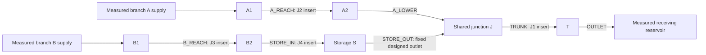

# Bench build and commissioning plan: 14–17 October 2026

Build the instrumented bench now, alongside the software work. An operator interview is useful for the later township decision and baseline, but it is not a prerequisite for drafting, fabricating or commissioning a laboratory experiment. The target is an assembled, surveyed and commissioned apparatus by the end of **16 October**, followed by the frozen validation sequence from **17 October** when the required records are ready. These dates are a prospective work plan, not completed work or a guarantee of laboratory availability.

No apparatus, parts, named participants, permission, measurements or physical benefit have been supplied by this project. No purchase, booking or outreach is made by this document. Use the available authorised laboratory/workshop procedures to put the plan into practice. The new preparation tool immediately generates blank run sheets while people, dimensions and records remain unknown.

## The question this rig should answer

Can measured restrictions, initial stored water and a receiving-water boundary explain which fixed restored configurations reduce spill and which transfer it to another location? The apparatus should expose that mechanism with a complete water balance and withheld observations. A visually impressive water demonstration alone cannot answer it.

Use **fixed geometry after a work cutoff, followed by dynamic event routing**. At the cutoff, record which jobs actually finished and passed the declared restoration check. Freeze that physical configuration and measure/reset the initial water state before releasing the prescribed event. Work that did not finish receives no assumed hydraulic benefit. An unverified intermediate condition is unresolved. This bounds the experiment without claiming water-conserving simulation of maintenance while water is moving.

Do not carry a hot-start state across changed geometry or imply that stopping the work clock makes stored water disappear. For this first rig, change inserts between independent, controlled resets; then record the starting levels/retained volume for the next event. Routing the subsequent transient is still necessary: a steady-flow calculation does not represent storage release, changing inflow or a cold-start response.

The existing v0.3 policy study remains unchanged: all four operational methods abstained in all ten designed synthetic events. This rig is a way to obtain missing evidence, not a reason to recast those ties as a demonstrated maintenance benefit.

## Apparatus that matches the model question

Preserve the topology and distinct intervention locations, not the old synthetic dimensions:



The receiving reservoir and supply/header reservoirs sit outside the measured network control volume. Catch and identify overflow separately at every potential spill location. Do not let one collector drain into another unmeasured, return to the network unnoticed, or become part of the retained-water measurement.

Prefer transparent **open rectangular channels** for the first rapid build, with measured modular junctions and storage. They make the water surface and restriction geometry inspectable and fit a supported section type. Clear PVC pipe is a different valid apparatus choice only when its measured circular section, connections, free-surface/pressurised regime and spill path are represented correctly. A cut pipe or half-round gutter is not a rectangle; do not enter its width and height into a rectangular model merely because it is convenient. An irregular proprietary gutter profile needs a supported measured representation or an explicit future contract extension. The current site importer supports open rectangle, trapezoid and circular sections only and remains staging-only.

EPA describes both open-channel and closed-conduit routing, their cross-section geometry and the distinction between receiving-head, inflow and initial-state inputs. Those capabilities do not establish that a homemade apparatus matches a particular model. [EPA SWMM Hydraulic Reference, sections 2.3 and 5](https://nepis.epa.gov/Exe/ZyPURL.cgi?Dockey=P100S9AS.txt).

Choose the available material around the required geometry and measurement access. Do not assume that visibility, nominal pipe diameter or a catalogue label is an as-built survey. Follow the material manufacturer's joining/curing instructions and the workshop's fabrication procedures; this plan does not prescribe unverified solvent, pressure or electrical arrangements.

| Assembly group | Concrete preparation task | Record before experiments |
|---|---|---|
| Seven link sections | Lay out A_REACH, A_LOWER, B_REACH, STORE_IN, STORE_OUT, TRUNK and OUTLET with adjustable supports. Mark permanent asset IDs. | Actual length, section dimensions, slope and endpoint inverts; distinguish nominal part size from measured geometry. |
| Junctions and storage | Provide the six junction locations A1, A2, B1, B2, J and T, storage S and receiving boundary O. Allow level reading and collector access. | Every wetted compartment's geometry and volume contribution. Represent material junction-box storage in the new bench model instead of silently treating it as zero. |
| Four restriction inserts | Make repeatable current/restored sections for J1–J4. Keep them distinct and mechanically repeatable. | Before/after dimensions, installed-position reference, photographs and uncertainty. STORE_OUT stays fixed. |
| Two branch supplies | Provide independently controlled branch A/B delivery and record actual inflow at the network boundary. | Prescribed forcing file, calibration, actual flow series and repeatability envelope. |
| Receiving boundary | Provide a controllable receiving level with independent level measurement and signed network exchange. | Head datum, actual level trace and direction convention for outward flow/backflow. |
| Spill collectors | Route every possible spill to a labelled collector outside the network's retained-water measurement. | Collector calibration, time series/volume method and saturation/overflow limits. |
| Complete storage measurement | Weigh the isolated wetted rig or use a documented sum of calibrated retained-volume measurements covering links and nodes. | Initial/final total water and uncertainty; forces from hoses/supports or shared-sensor dependencies accounted for. |
| Instrument/data station | Establish a common clock, stable datum marks, instrument IDs and raw-file storage. | Calibration validity, expanded uncertainty, sampling interval, missing/saturated-data flags and immutable raw records. |

No cut lengths, diameters, water depths or flow readings in this document are asserted as measured. Complete an as-built cut/survey sheet from the actual apparatus, then produce a **new bench model**. Existing synthetic inputs and results must remain intact. Small-scale travel times and instrument response may require different routing settings; establish numerical convergence for the bench model before its validation freeze instead of copying the synthetic timestep blindly.

## Flow supply: control and measure it

A stable gravity-fed header is a good first configuration when the laboratory can maintain its head and provide suitable containment. A simple elevated tank that empties is not automatically a constant-head supply. Record header level, maintain the selected condition through the facility's approved arrangement, and measure both branch inflows throughout the event. A pump can replenish a header or drive a controlled loop, but its nameplate flow is not the inflow hydrograph.

A centrifugal pump's operating point depends on the intersection of its pump curve and system curve; changing head, tubing or valve resistance changes delivered flow. This is why the bench uses actual boundary measurements. [KSB, Operating point](https://www.ksb.com/en-global/centrifugal-pump-lexicon/article/operating-point-1117036).

Before dynamic events, calibrate at several **actual operating settings across the intended range**, repeat collections and check drift. For a timed gravimetric collection, derive average volume flow from collected mass change, elapsed time and an appropriate water-density value for the recorded temperature. Include scale, timing, diversion/collection, temperature/density and repeatability contributions. A single timed bucket reading is an average over that interval; it cannot establish the transient shape or fast sensor response. NIST's primary methods illustrate mass/volume accumulation over time and explicit uncertainty analysis; its laboratory accuracy must not be copied onto this rig. [NIST, Liquid Flow Standards](https://www.nist.gov/laboratories/tools-instruments/liquid-flow-standards), [NIST SP 250-98](https://www.nist.gov/publications/liquid-flow-meter-calibrations-nists-15-kgs-water-flow-standard).

Freeze the commanded hydrograph and its permitted reproduction envelope using calibration evidence before validation. Measure the actual input in both paired runs. A shared forcing-file hash identifies the same prescription, not magically identical delivered water. If a run misses the predeclared forcing envelope, keep its record and exception; do not adjust the later pair or remove the earlier result to manufacture a benefit.

## People: separate access authority from scientific review

| Role | Responsibility | What it does not establish by itself |
|---|---|---|
| Build lead | Inventory available parts/instruments, layout, fabrication, as-built labels, reset execution. | Engineering acceptance of the hydraulic mechanism. |
| Campus facilities/laboratory custodian | Authorise the actual space, bench loading, water/electrical arrangement, workshop use and water disposal under local procedures. | Acceptance of the experiment's model, calibration or policy claim. |
| Lecturer/scientific reviewer | Review model consistency, survey/datum, uncertainty, controlled variables, calibration/validation split and frozen run sheet. | Permission to use a facility or alter campus drainage unless that authority is separately delegated. |
| Data custodian/recorder | Synchronise clocks, retain raw files and hashes, record resets, deviations and failures without relabelling events. | Proof that reported readings or declarations are authentic without their underlying records. |
| Later township drainage operator | Supply real workflow constraints, a competent baseline and site interpretation for the later field/shadow stage. | A prerequisite for preparing this controlled bench or a substitute for laboratory authority. |

One person may hold more than one authorised role; document that arrangement. Blank names remain blank until people actually take responsibility. The preparation checklist records supplied documentary claims only: it cannot grant facility permission, scientific approval or physical validation.

## Four-day execution sequence

| Date and target | Work to complete | Evidence produced / decision at the end |
|---|---|---|
| **14 October — lock the build approach** | Generate the blank preparation pack now. Inventory available space, material and instruments. Select open rectangular channels or an explicitly modelled circular alternative; lay out the seven links, storage, four inserts and collectors. Define the complete control volume and assign the actual facility/science/data roles as available. | Labelled layout and parts/cut list with actual unknowns retained. Draft run order and records exist even before participants are confirmed. No operator interview blocks this work. |
| **15 October — assemble and survey** | Assemble in the permitted space; complete required cure/setup checks. Mark the datum and asset IDs. Survey every installed link/junction/storage and current/restored insert. Establish the receiving boundary and two measured inflows. Perform dry acquisition and clock tests, then staged leak checks under the lab's procedures. | As-built survey, photographs, control-volume inventory, leak/loss investigation and raw commissioning logs. A transparent flow demonstration can happen only within the approved setup; it is still commissioning. |
| **16 October — commission, calibrate and freeze** | Calibrate flow, stage, retained volume and collectors; check actual boundary control, repeatability, sensor range and sample timing. Collect distinct BENCH-CAL-* events. Build/check the separate bench model, fit only supported parameters, and freeze its lineage. Review/reset the apparatus, exact forcing, analysis windows, stop rules and all 24 planned IDs/pairs/order. | Target: an operational laboratory apparatus before 17 October, with commissioning and model/run-sheet evidence. The unchanged thresholds must be achievable with the measured uncertainty budget. If a protocol change is needed, register it before any new validation collection. |
| **17 October — execute withheld runs and inspect evidence** | Execute the fixed sequence below only after the preceding documentary/physical checks are resolved by the responsible people. Reset independently every time. Keep original raw readings and all unsuccessful runs. Analyse using the frozen model and the measurement checker; compare branch spill, storage, stage and signed exchange. | Actual paired observations and transparent pass/fail/unresolved results. Complete all 24 only if the predeclared event windows, resets and supervised operating time permit; otherwise retain completed blocks and explicitly list the remaining IDs as pending. Do not shorten the recession window or invent coverage to meet a calendar target. |

The critical path is instrumentation and complete water accounting, not appearance. If a required instrument is unavailable, keep building the apparatus and software records while that item remains unresolved. A commissioning demonstration can still be documented as development; it must not be relabelled a completed withheld experiment.

## Commissioning checks that make the comparison interpretable

1. **No-water and known-water checks.** Confirm clock/data capture and scale zeros without treating a zero as a calibration. Add known/independently measured water amounts over the working range, record the datum, and check recovery after drainage. Include hoses, channels and junction storage, not only S.
2. **Leak and hidden-loss accounting.** With the intended configuration, test retained water over a declared interval and investigate unexplained loss. Distinguish collection loss, leaking joints, evaporation, timing and sensor drift. Record an evidence-backed upper bound for any unmeasured loss; do not declare it zero by assumption.
3. **Flow and boundary calibration.** Check multiple delivery settings and signed receiving exchange, including the direction convention. Measure the receiving level directly. A pump setting or tank mark is a control instruction, not a measured boundary series.
4. **Stage/volume relation.** Record the actual vertical reference and calibration across the intended range. Validate the total retained-water method independently of the solver. Check that installed inserts and wetted supports have not changed the volume accounting.
5. **Sampling and dynamic response.** Confirm common timestamps, a target interval of one second where instruments support it, no interval above the frozen five-second maximum, and enough response speed for the imposed changes. The checker cannot recover a missed peak, saturation or a missing interval.
6. **Cutoff and independent reset.** Record installed current/restored geometry before release. Complete the reset recipe, receiving condition and initial storage check for every run; do not carry a favorable water distribution from the previous run. Cold-start and equilibrated controls retain their distinct initialisation definitions.
7. **Calibration freeze.** Retain all calibration event IDs and the frozen model identity. Validation is a separate event partition. Observed inflow and imposed outfall-stage replay are inputs; matching those inputs is not independent response evidence.
8. **Predeclared stop and exception handling.** Specify instrument saturation/dropout, loss of datum/clock, collector capacity, unstable supply/receiving control, leakage and apparatus conditions requiring a stop under the laboratory procedures. Record a stopped run and its cause. Repeats are new records; do not silently overwrite a planned event or delete a poor outcome.

The unchanged bench protocol requires a conservative uncertainty bound alongside every arithmetic check. Its balance tolerance is the greater of 0.5 L or 3% of initial storage plus inflow plus receiving backflow; stage RMSE is 10 mm, flow RMSE 0.020 L/s, storage RMSE 0.5 L, and spill-volume error the greater of 0.5 L or 10% of measured location spill. These are project thresholds, not an engineering standard. A decision effect smaller than the combined uncertainty or acceptance band cannot support a confident benefit claim. Resolve that through a reviewed prospective design, not by lowering uncertainty after seeing results.

## Fixed validation order and paired resets

The protocol's event IDs, odd/current and even/restored assignments and pairs remain unchanged. The preparation pack fixes block order as listed and uses **01, 02, 04, 03** within each block. Pair 01/02 runs current first; pair 03/04 runs restored first. This counterbalances a simple within-pair order effect without claiming randomisation or statistical independence. It does not justify rearranging runs after seeing the first response. Two independently reset pairs are a small designed mechanism check, not a population estimate.

| Block | Mechanism | Fixed run order; retain these exact event IDs |
|---|---|---|
| 1 | H2 risk transfer | BENCH-VAL-H2-01, BENCH-VAL-H2-02, BENCH-VAL-H2-04, BENCH-VAL-H2-03 |
| 2 | Roughness | BENCH-VAL-ROUGH-01, BENCH-VAL-ROUGH-02, BENCH-VAL-ROUGH-04, BENCH-VAL-ROUGH-03 |
| 3 | Restriction | BENCH-VAL-RESTRICT-01, BENCH-VAL-RESTRICT-02, BENCH-VAL-RESTRICT-04, BENCH-VAL-RESTRICT-03 |
| 4 | High receiving stage | BENCH-VAL-STAGE-01, BENCH-VAL-STAGE-02, BENCH-VAL-STAGE-04, BENCH-VAL-STAGE-03 |
| 5 | Cold start | BENCH-VAL-COLD-01, BENCH-VAL-COLD-02, BENCH-VAL-COLD-04, BENCH-VAL-COLD-03 |
| 6 | Equilibrated control | BENCH-VAL-EQUIL-01, BENCH-VAL-EQUIL-02, BENCH-VAL-EQUIL-04, BENCH-VAL-EQUIL-03 |

Freeze the exact intervention subset, geometry, forcing and window for each pair in the witnessed run sheet before validation. Keep the designed storage outlet unchanged. A failed H2 transfer hypothesis, harmful restoration or unresolved measurement is a result to retain. The current collector-spill measure does not automatically represent property flooding or avoided damage.

## Generate the preparation pack now

`monsoon.bench_preparation` is additive; it does not modify the frozen physical protocol, scientific sources, v0.3 results, site importer or measurement checker. Its APIs are:

- `blank_bench_readiness()` returns an explicitly unfilled documentary checklist.
- `validate_bench_readiness(payload)` reports schema issues, missing items and supplied documentary completeness. Every permission/approval/physical-validation/activation claim remains false.
- `prepare_bench_pack(payload=None, output_dir=None)` immediately returns the plan and 24 unfilled run sheets. Omitted input creates the blank draft. A `files` mapping provides UTF-8 text files for a complete ZIP download. Optional output creates a new full-hash directory and refuses to overwrite an existing pack.

From the project folder, the prepared workspace runtime can generate a draft pack with:

```powershell
& '../../work/runtime/venv/Scripts/python.exe' -m monsoon.bench_preparation --output 'var/bench-preparation'
```

Supply `--input path/to/readiness.json` only when documentary declarations exist. Missing participants, timestamps, survey/model hashes and checklist evidence stay null/missing and do not prevent draft generation. Unexpected measurement/result fields, altered protocol identities, or attempts to replace the fixed order are rejected. The generator never imports or invents actual observations, predictions, dimensions or participation. A complete checklist is still a claim pending evidence review, not permission to operate.

The pack contains a README, readiness declarations/checks, complete plan, unchanged protocol copy, combined printable run sheets, 24 individual Markdown sheets and a raw-byte checksum manifest. Actual timestamps and observed/predicted data cells remain blank. Its canonical identity binds the input declarations, tool contract version, protocol version/hash and fixed plan; changing those declarations generates a different pack.

The bench protocol remains `MONSOON-BENCH-01` version `1.0`, canonical SHA-256 `cc7f5c8eb301f0be18aa54d43a93420d54dbf5237aa8d520acc994063ea83d26`. It still requires responsible review before collection. If review changes thresholds, instrumentation assumptions or the experiment design, preserve this protocol and register the next version before new validation events. Do not revise the existing study after outcomes.

## What can be said confidently

The project already executes drainage maintenance comparisons, exposes transfer of harm, applies common decision constraints and refuses unsupported work. The next concrete deliverable is a commissioned rig and measured mechanism evidence with uncertainty, not a promise that one algorithm wins. After real collection, state the exact tested configurations, failures and limits. Physical evidence should earn any stronger claim; a more confident narrative cannot substitute for it.
