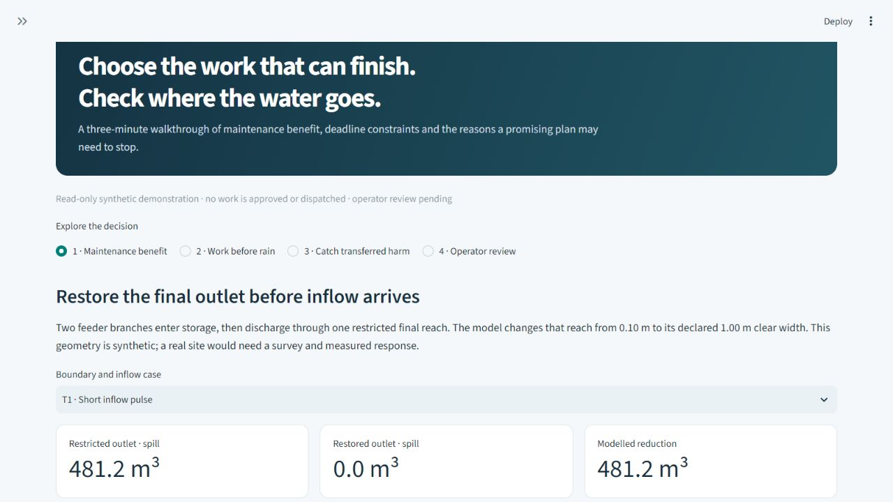

# Monsoon Rehearsal

**Choose drainage work that can finish before rain—and check where the water goes.**

Version 0.9.0 adds a three-minute guided demonstration and a prospectively declared outlet-restoration benchmark. Start with **Demonstration** in the sidebar; use **Rehearse** for the full four-job planning workflow.

**No Google API key is required.** Captured third-party webpage credentials have been redacted; the application and rainfall values are unchanged. See the [publication cleanup record](SECURITY_REDACTION.md).

| What you can inspect | Current evidence |
| --- | --- |
| Maintenance benefit | Four separate synthetic outlet-restoration cases pass unchanged numerical and represented-location checks; zero-inflow control passes. |
| Boundary limits | High-backwater control remains unresolved. The original interacting network's adverse cases remain visible. |
| Scheduling | Bounded job durations, travel, prerequisites and crew return; work that cannot fit is skipped. |
| Baselines | The original planner ties adaptive marginal; the new one-job case ties downstream-first. Scheduling superiority is not established. |
| Tickets | Persistent draft, review, approval and dispatch controls tied to exact-plan evidence. The demonstration cannot grant approval. |
| Practitioner evidence | Blank review packet ready. Actual operator review, measured validation and shadow trial remain pending. |

[Live demonstration guide](docs/DEMONSTRATION.md) · [Verification](evidence/v0.9/VERIFICATION.md) · [Benchmark rationale](docs/MAINTENANCE_CASE.md) · [Results and raw-run manifest](evidence/v0.9/maintenance-benchmark/) · [Operator review packet](docs/OPERATOR_REVIEW_PACKET.md)



The practice conversation in `docs/FICTIONAL_REVIEW_PRACTICE.md` is explicitly invented and is not a testimonial. No external organisation has endorsed this prototype.

## Product and evidence boundaries

An executable research prototype for deciding which drainage restoration jobs a limited crew can complete before a common pre-storm deadline. It connects an actual EPA SWMM dynamic-wave model, exhaustive scheduling, explicit baseline comparisons, and a persistent reviewed-ticket workflow.

**The hydraulic study data are synthetic. This is a verified software prototype, not a calibrated field decision system.** The original reference result ties the adaptive marginal baseline; one held-out storm violates the location-level safeguard. The v0.3 observation-conditioned policy and all three screened alternatives abstain in all ten designed evaluation events. **No scheduling advantage has been demonstrated.** Those outcomes remain part of the evidence.

**The main application focuses on the SWMM product.** The default pages are Rehearse, Demonstration, Work window, Work tickets and Evidence. **Show research tools** explicitly opens the separate validation workspaces. Read `PRODUCT_SCOPE.md` for the product verification profile and the distinction between an inspectable prototype and established operational benefit. Frozen earlier verification remains under `evidence/v0.8/` and `evidence/v0.8.1/`; new demonstration evidence is separate under `evidence/v0.9/`.

**Custom-solver development is stopped for this delivery after the 17 October strategy review.** The separate v0.7 bench research conserves water but remains unqualified because its complex-pulse mesh-accuracy check fails. A passing v0.8 product profile does not accept that solver, repair the earlier SWMM bench failures or demonstrate a scheduling advantage. See `evidence/v0.7/VERIFICATION.md` for the retained results. The previous archives remain unchanged.

**Historical replay stays bound to its original implementation.** The v0.8.1 adapter now handles brief Windows sharing locks when publishing its optional cache index, while preserving the sealed simulation evidence. Hydraulic calculations and acceptance criteria are unchanged, but the adapter's source fingerprint is different. The strict v0.3 recorded-study replay therefore rejects this runtime; use the preserved v0.8 source package and matching recorded environment for that historical reproduction. Its original records and binding checks have not been rewritten. Version 0.9 retains that hydraulic adapter and uses its own application/source identity.

## Open the prototype

For Streamlit Community Cloud, deploy `app.py` from `main` and select **Python
3.12** in **Advanced settings**. Python 3.14 is outside this release's supported
range. The root `requirements.txt` installs the pinned release dependencies.
See [cloud setup and verification](docs/DEPLOYMENT.md), including how to recover
an app created with the wrong Python version.

On this Windows workspace, double-click **Start.cmd**. The launcher reuses the prepared environment and serves the app at **http://127.0.0.1:8513**. Keep its window open while using the app. Press Ctrl+C to stop it.

If moving the source folder to another computer, install Python 3.11, 3.12 or 3.13 first. The launcher creates `.venv` and installs the pinned dependencies on its first run. Installation requires internet access; the application runs locally without map tiles, forecast feeds, API keys, or cloud services. The original synthetic demonstration needs no account. The new operator/shadow research workspace requires locally created accounts, with no default credentials.

Manual setup, from this folder:

```powershell
python -m venv .venv
.venv\Scripts\python.exe -m pip install -r requirements.lock.txt
.venv\Scripts\python.exe -m streamlit run app.py
```

For a different port: `./Start.ps1 -Port 8514`. Bind to localhost. The original Work tickets page still uses named audit labels; authentication in the separate research workspace is not production identity assurance or proof of professional qualifications.

## Start the validation phase

Enable **Show research tools**, then open **Validation** in the sidebar. These research tools support a later measured bench/site investigation; they are not prerequisites for running the supported product demonstration. No real operator or measured dataset has been supplied, so external validation remains pending.

Development, bench preparation and interviews run in parallel. The operator gate applies to validating a real decision and operational use; it does not block building or testing. Begin with a campus facilities drainage/maintenance operator for workflow input and a separate civil engineering reviewer for technical input. The four-job synthetic network is already frozen; this release preserves it and every previous policy result.

Open **Work window** to inspect an earlier stop without giving the queue selector future stop information. The synthetic illustration credits no actual inspection. The observed-record audit separates completion reports, condition verification, information available at the stop, later evidence and unresolved/interrupted work. It cannot authorise a hydraulic restart or automatically treat an unfinished job as unchanged. See `WORK_WINDOW.md`.

Open **Validation → Bench preparation** to generate a draft immediately, with 24 unfilled run sheets and a fixed paired order. Readiness declarations, missing roles and evidence remain explicit. `BENCH_BUILD.md` brings apparatus assembly and commissioning into 14–17 October; those are targets, not a report that construction occurred. Clear open channels and repeatable measured inserts should match the chosen model; generic tubing or sponge blockage is not an interchangeable hydraulic representation.

Open **Validation → Bench model** for the preserved v0.5 bench model and calibration study workflow. Supply site geometry, compartment stage–area curves, roughness, minor losses, spill collectors, numerical settings and event boundary conditions. The engine counts water in compartments and conduits, preserves signed outlet exchange and applies the earlier endpoint and time-step checks. The supplied synthetic example is an executable software exercise, not a physical experiment. Runs preserve their exact inputs, engine identity and outputs for download. See `BENCH_MODEL.md`; use the v0.6 workspaces below for the stronger cumulative checks.

Open **Validation → Wet preparation** to carry a modelled water state from a dry preparation into a later test without resetting the solver. Preparation and evaluation keep the same geometry and have separate water balances. The numerical stationarity check, when requested, is distinct from physical equilibration. See `BENCH_INITIALIZATION.md`.

Open **Validation → Boundary replay** to freeze a dry-start model and an input-processing recipe, receive the actual boundary traces separately, seal internally calculated predictions, and only then receive response readings. Missing or failed attempts remain in the study. Planned target curves are kept separate from supplied inputs. See `BENCH_REPLAY.md`.

These two v0.6 workspaces are separate research capabilities. Measured replay does not yet support the prepared wet state. Neither capability completes the original 24-event physical protocol, authenticates observations, establishes model accuracy, or authorises maintenance. Supplied forms start blank; synthetic exercises are explicitly labelled.

**Stronger numerical checks found an important limitation:** the earlier three-node bench pulse examples can pass endpoint balance and step-halving checks while failing cumulative balance during the event. Their original evidence remains unchanged, but those predictions do not qualify for the new replay study. The earlier positive bench demonstration uses a separately declared simple analytical compartment; it is distinct from the v0.9 outlet-restoration case. It demonstrates the recording and conservation checks; it does not resolve the complex-network discrepancy or establish wet-conduit/backwater accuracy. Adverse results are retained with this release.

Under the preserved **Bench model → Calibration & freeze**, create a local study, record calibration responses, select one calibration-used model and freeze the future event plan. Later responses are compared with predictions generated internally from that frozen model; uploaded predictions are not accepted. There is no automatic parameter fitting. Source attachments and local chronology are checked without claiming that a local clock or checksum proves physical truth. See `BENCH_STUDY.md`. These records use the earlier numerical gates; new studies should use **Boundary replay**. Neither workflow has site activation or dispatch authority.

**The original bench adapter and the Boundary replay study support nominally dry starts and fixed geometry.** Continuous Wet preparation is available separately; arbitrary wet-state assignment, measured prepared-state replay, unrepresented lateral channel overtopping and surface re-entry remain unsupported. The release therefore cannot execute every family in the existing 24-run protocol. Keep that protocol intact; review and prospectively register any narrower or revised physical experiment before collecting its validation responses.

1. **Readiness** explains what is prepared and what still needs participants or observations. Download the validation plan, physical protocol and draft data contract.
2. **Site & measurements** checks an uploaded JSON package, compares versions, and calculates measurement balance/response metrics. The downloadable examples are synthetic fixtures. A structurally complete import neither activates a site model nor proves that its survey is true.
3. **Policy comparison** shows the new frozen observation-conditioned research experiment, its simpler equally informed baselines, all results and limitations. It does not dispatch work or replace the original failed evidence.
4. **Operator & shadow** first asks you to create a local administrator. Sign in and create named research accounts; use separate submitter and reviewer accounts. Stage a site, record the operator's baseline before disclosing the model, and seal a prospective shadow decision before appending observations. Follow `OPERATIONS.md` for the record contracts and programmatic backup/recovery. Do not enter invented observations to complete a stage.

The complete sequence and external completion criteria are in `VALIDATION_PLAN.md`. The schema remains a draft pending operator acceptance. Site-model activation, professional approval, physical experiments and live maintenance remain outside this software release.

## First complete exercise

1. Open **Rehearse**. Keep the four planning scenarios and 180-minute deadline, then choose **Run rehearsal**. A cold run takes longer because it launches real engine calculations; identical inputs reuse checked results.
2. Inspect the network schematic, grouped baseline comparison, priority queue, scenario-specific completed jobs, crew timeline, node metrics, depth traces and raw SWMM report. The queue is a priority rule: skip a job that cannot fit and consider the next eligible job. It does not promise that every listed job will finish.
3. Select the recommended planning-admissible plan and choose **Audit selected plan**. The audit checks every achieved work prefix and final state against no additional work, including the revealed holdouts and nine prescribed sensitivity cases. Each hydraulic state requires step-halving and event-horizon evidence.
4. Inspect failures and unresolved checks. The default selected queue fails the location-level safeguard in H2. **This is an expected scientific finding: it must not be approved.** You may save it as an immutable blocked draft and download its printable HTML briefing. Review, approval, ticket creation and dispatch require a complete passing audit bound to the exact plan and observed state.
5. Open **Work tickets** to confirm that the saved failed or unaudited plan cannot be reviewed or approved. Old records remain available as explicitly historical evidence. The separately labelled automated workflow fixture tests review, approval, dispatch, reported completion, verification and replanning; it is not field or hydraulic performance evidence.
6. Open **Evidence** for original numerical verification, all holdout results, current development checks, public data provenance and model limitations. Export the rehearsal, briefing and workflow records.

Failed verification keeps condition unresolved and prevents supported replanning. An unstarted ticket can be cancelled. Recording a crew delay advances the observed clock and requires a new rehearsal and approval. Changes to scenarios, deadline, job definitions, engine or implementation invalidate old approvals. Observations from work already started can still be reported against their historical scope.

## What is implemented

- **Hydraulics:** EPA SWMM 5.2.4 through `swmm-toolkit`, dynamic-wave routing, prescribed branch hydrographs, fixed downstream stage, online designed storage, initial stored water and explicit collector-boundary node spill. Each run executes in an isolated process and preserves its input, report, binary output, logs, checksums and manifest.
- **Interventions:** four distinct clear-width restorations. They preserve invert, channel depth, roughness and the designed storage outlet. Every job has its own physical mapping; the model does not invent a hydraulic dependence on work order when the final state is identical.
- **Scheduling:** enumerate all 65 ordered subsets of four jobs. Dispatch uses only available information; maximum occupation time, travel, prerequisites and return reserve govern starts. Realised duration is read after dispatch. Every achieved prefix and final state is screened under the finite declared scenarios.
- **Comparison:** no discretionary work; explicit downstream-first topology heuristic; adaptive marginal benefit; nominal deterministic schedule; robust finite-scenario queue; optional user-entered queue. Same replay and hydraulic rules apply. The separately labelled hindsight oracle has additional information and cannot select the operational policy.
- **Workflow:** durable SQLite plan snapshots, mandatory plan-specific stress audit, review, approval, ticket assignment, actual work reporting, verification, closeout, delay observation and replanning. Missing, tampered, stale, failed or unresolved audit evidence blocks new approval and dispatch. Optimistic version checks and transactions protect against concurrent changes. Audit events and saved plan evidence are protected by database triggers.
- **Interface:** local browser application with scenario/deadline controls, schematic, charts, actual completed subsets, skip reasons, plan-specific failure inspection, printable self-contained HTML briefings, hydraulic files and evidence exports.
- **Public data:** explicit METMalaysia forecast/warning snapshot adapter with exact source bytes, retrieval dates, SHA-256, coverage and missing-field reporting. The archived context does not alter the frozen synthetic model or imply numeric rainfall intensity. See `evidence/PUBLIC_DATA.md` for other acquisitions and unavailable/request-only data.

## Reproduce the evidence

Use the prepared workspace interpreter `../../work/runtime/venv/Scripts/python.exe` here, or `.venv/Scripts/python.exe` in a fresh installation.

```powershell
.venv\Scripts\python.exe -m pytest -c pytest-product.ini -q --junitxml=var/reproduction/pytest.xml
.venv\Scripts\python.exe -m monsoon.verify --output var/reproduction
```

The first command uses the explicit product profile: real-engine numerical tests, adversarial regressions, immutable audit-binding checks, site/measurement checks, authenticated shadow records and application workflows. It excludes the separate `test_bench*.py` research modules; all their files and adverse evidence remain preserved, and a profile pass is not a full research-suite pass. Running pytest without that profile still collects the full research suite. The verification command records the blocked real candidate and real empty-queue approval separately from the arithmetic positive-work fixtures. Original v0.1–v0.6 evidence remains historical; v0.7 records the unqualified custom solver. Current product regression is recorded under `evidence/v0.9/`, with the earlier engine verification retained under `evidence/v0.8/`; use a fresh local output folder so historical evidence stays intact. No interactive ticket is completed by verification. A test-suite pass means the checks behave correctly, not that every maintenance plan passes its scientific audit. See the policy experiment's frozen protocol and result files for its separate reproduction instructions and limitations.

`MONSOON_DATA_DIR` can isolate another interactive workspace. `MONSOON_CACHE_DIR` can share content-addressed hydraulic calculations while keeping workflow databases separate. Deleting a cache is unnecessary; model, engine and metric-contract changes produce different identities. Current workflow data and raw run caches under `var/` are excluded from the source bundle. Selected historical diagnostic outputs and public EPA examples remain packaged as evidence. There is no automatic reset or deletion of work history.

On Windows, keep the checkout and `MONSOON_DATA_DIR` path short. The continuous-preparation and cumulative-audit workers use local native filenames and verify the complete output inventory; their regression tests cover output paths longer than 260 characters. Windows subprocess working-directory limits still apply, and the preserved v0.5 parent worker retains its earlier absolute-filename limit. The v0.6 package check used the folder location that exposed its new-worker bug. Each release's separate package-check record specifies its actual tested location; unrestricted Windows path support is not claimed.

## How to read the result

The selected reference priority queue begins **J4 → J1 → J3 → J2**. Its actual completed subset varies by observed duration. **The robust queue ties the adaptive marginal method in all four planning cases.** The case establishes a working, inspectable comparison system; it does not establish that the robust planner improves on a competent adaptive scheduler.

In **H2**, the robust and adaptive policies produce lower total spill than some supported alternatives but increase spill at protected location B2. They are therefore **inadmissible**. Do not describe that lower total as a successful result or as beating the admissible hindsight oracle. The downstream-first comparator is a declared topology rule awaiting operator review, not a validated representation of professional maintenance practice.

The model's spill is water removed at a named drainage-model boundary. It is neither a mapped street flood nor a property-damage estimate. Scenario-grid averages are not annual expected losses or forecast probabilities. High-tailwater diagnostics can remain duration-sensitive; see the horizon checks and model notes before interpreting a three-hour quantity as a whole-event volume.

## Source map

| File | Responsibility |
|---|---|
| `app.py` | Browser workflow and inspection views |
| `monsoon/demo_ui.py`, `monsoon/maintenance_benchmark.py` | Read-only walkthrough and separately frozen native outlet-restoration benchmark |
| `monsoon/case.py`, `data/reference_case.json` | Frozen synthetic case and provenance |
| `monsoon/hydraulics.py`, `_swmm_worker.py` | Input construction, isolated EPA engine, unit conversion, checked cache |
| `monsoon/planning.py` | Exact queues, causal replay, baseline policies, protected-location gates, holdouts |
| `monsoon/tickets.py` | Transactional state machine and immutable evidence |
| `monsoon/service.py` | Input identities, stale-plan protection and orchestration |
| `monsoon/assurance.py`, `assurance_hydraulics.py` | Bound stress audit, raw-artifact verification and numerical evidence |
| `monsoon/briefing.py` | Escaped, self-contained printable plan and workflow evidence |
| `monsoon/public_weather.py` | Explicit public weather snapshots; never changes hydraulic inputs |
| `monsoon/site_data.py`, `monsoon/measurements.py` | Inert site intake, revision comparison and measured-data checks |
| `monsoon/observed_policy.py`, `monsoon/policy_evaluation.py` | Frozen controlled-boundary research policy and equal-information comparison |
| `monsoon/policy_replay.py` | Guarded replay of the exact recorded study event, observation and decision |
| `monsoon/operations.py` | Authenticated local research records, evidence provenance and prospective shadow workflow |
| `monsoon/validation_ui.py`, `monsoon/operations_ui.py` | Validation workspace and research record forms |
| `monsoon/work_window.py`, `monsoon/preparation_ui.py` | Early-stop timing/observation audit and preparation forms |
| `monsoon/bench_preparation.py`, `BENCH_BUILD.md` | Documentary checklist, unfilled paired run sheets and early apparatus work |
| `monsoon/bench_model.py`, `_bench_worker.py`, `bench_study.py` | Preserved v0.5 dry-start adapter and declared-forcing study; earlier endpoint checks |
| `monsoon/bench_initialization.py`, `_bench_initialization_worker.py` | Continuous fixed-geometry preparation, event state, phase and cumulative balance gates |
| `monsoon/bench_balance_audit.py`, `_bench_balance_worker.py` | Additional every-routing-endpoint audit of both exact v1 input files |
| `monsoon/bench_replay.py` | Separate boundary receipt, prediction seal, withheld response and complete evidence export |
| `monsoon/bench_next_ui.py`, `bench_next_demo.py` | New research forms and explicitly circular software exercise |
| `monsoon/verify.py` | Reproducible integration evidence |
| `tests/` | Numerical, scheduling, workflow, concurrency and UI regressions |
| `data/MODEL_NOTES.md` | Geometry, metrics, assumptions and source references |
| `TICKET_API.md`, `CONTRACTS.md` | Domain interfaces |

## Scope for the next build

The broader blueprint remains the project direction. The active hydraulic prototype uses one crew, four independent jobs, dry work before the hydraulic event, uniform travel, binary verified restoration and a small declared scenario set. v0.3 adds staged survey-data import and authenticated research/shadow records. It does not activate an imported hydraulic model and has no measured site calibration, rainfall-runoff calibration, operational live-weather decision feed, wet-work interruption model, multiple-crew routing, completed physical rig or cloud dispatch. Public API snapshots demonstrate ingestion only.

Custom-solver research remains paused; its accounting and accuracy failures retain their recorded outcomes. The next scientific task is independently justified operator/intervention scope and measured response, followed by a separately frozen evaluation. Product-interface work can proceed alongside collecting those records. Expand the policy/model only after documenting those inputs and freezing new evaluation cases. Winning a competition depends on evidence and execution; the software cannot guarantee a prize.

Use `DEVELOPMENT_DECISIONS.md` for the accepted/corrected Gemini suggestions and supported product claims, `VALIDATION_PLAN.md` for the operator-to-pilot sequence, and `EVIDENCE_ROADMAP.md` for the earlier data-request specification. Current product regression verification belongs under `evidence/v0.9/`; the previous interface regression remains under `evidence/v0.8.1/`; the frozen v0.8 report remains under `evidence/v0.8/`, and unqualified bench research under `evidence/v0.7/`; v0.3 policy results remain frozen under `evidence/v0.3/`. Older evidence remains historical. This is a source-and-evidence delivery, not a hackathon submission.

## Decision-interface update (v0.8.1)

The selected plan and its current audit status appear before detailed plots. Use **Inspect audit findings** for the actual required case and achieved work state; this inspector is separate from planning-scenario selection. Depth traces require an exact audit-bound result checksum. **Select no additional work** changes the inspected queue only: its own audit, review and approval are still required, and it cannot issue a job ticket. Scenario schematics distinguish absolute spill from signed change against the matching no-additional-work result. Missing measurements remain unavailable. Completion-reported work remains unresolved until verification. No solver, uncertainty envelope, protected location or acceptance threshold changed.
